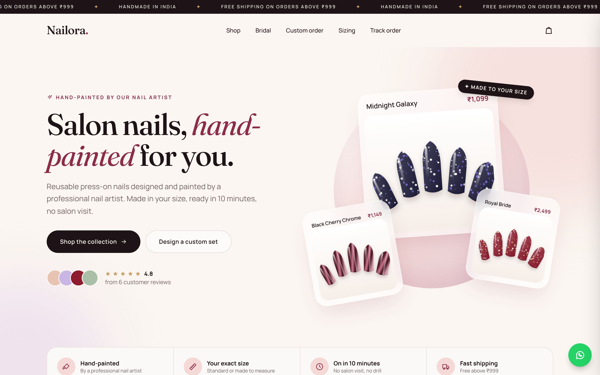
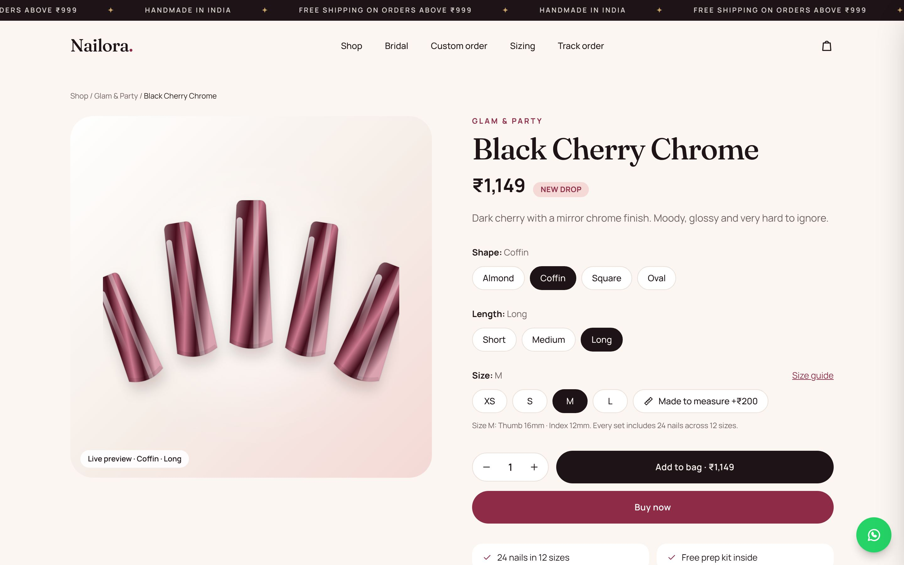
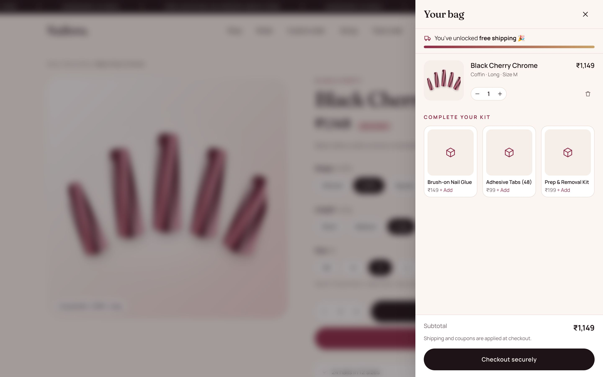
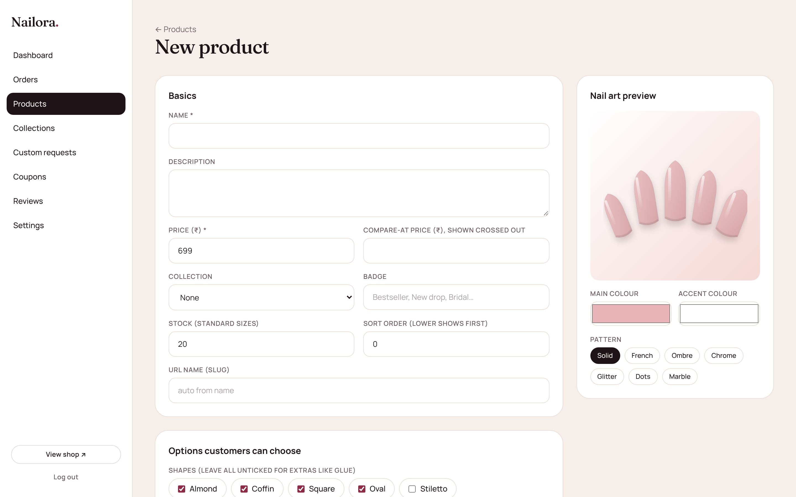

# Nailora: Online Store for Hand-Painted Press-On Nails

A complete, dynamic online store for selling handmade press-on nails, custom designs and bridal sets. Everything on the site (products, prices, photos, collections, coupons, shipping fees, banner text, home page headline) is stored in a database and can be changed from the admin panel without touching code.

> "Nailora" is a placeholder name. Change it in **Admin → Settings**.

| Home | Product page |
|------|--------------|
|  |  |
| **Bag** | **Admin: add / edit product** |
|  |  |

## Plan documents

| # | Document | What it covers |
|---|----------|----------------|
| 0 | [Market research](docs/00-market-research.md) | Market size, growth, competitors and prices, our position, realistic revenue |
| 1 | [Business plan](docs/01-business-plan.md) | Products, pricing, costs, brand, legal setup, marketing, 90-day roadmap |
| 2 | [Customer and order flows](docs/02-flows.md) | Customer journey, custom orders, fulfilment, returns |
| 3 | [Website build plan](docs/03-website-build-plan.md) | Pages, features and phases |

---

## Tech stack

| Part | Technology | Why |
|------|-----------|-----|
| Website framework | **Next.js 16** (React 19, App Router, server components) | Fast pages, good for Google search, frontend and backend in one project |
| Language | **TypeScript** | Catches mistakes before they reach customers |
| Design | **Tailwind CSS 4**, custom design system, Fraunces + Manrope fonts | Modern, mobile-first look that's easy to adjust |
| Database | **Prisma ORM** + **SQLite** (local) → **PostgreSQL** (live) | All products, orders and settings are dynamic |
| Payments | **Razorpay** (UPI, cards, netbanking, wallets) + **Cash on Delivery** | The ways Indian customers pay |
| Admin login | Password + signed, http-only cookie | Simple and secure for a small team |
| Product art | Custom SVG generator | Every design looks good even before you upload real photos |
| Photo sizing | **MediaPipe Hand Landmarker** (runs in the customer's browser) | Finds fingers in the hand photo so measuring dots start in the right place |

## How a customer orders

```mermaid
flowchart LR
    A[Instagram / Google] --> B[Home or Shop page]
    B --> C[Product page<br/>pick shape, length, size<br/>live preview updates]
    C --> D{Size}
    D -- XS/S/M/L --> E[Add to bag]
    D -- Made to measure --> D2[Enter 5 nail widths in mm<br/>or 'send on WhatsApp later'] --> E
    E --> F[Bag: free-shipping meter<br/>+ add-on suggestions]
    F --> G[Checkout: contact, address,<br/>coupon, payment method]
    G --> H{Payment}
    H -- UPI / card --> I[Razorpay popup → paid ✓]
    H -- Cash on delivery --> J[Order saved →<br/>'Confirm on WhatsApp' button]
    I --> K[Confirmation page with live status]
    J --> K
    K --> L[Track any time at /track<br/>with order no. + phone]
```



1. **Browse.** Shop by collection (Everyday, Glam, Bridal & Festive, Essentials), filter by shape, sort by price, or search.
2. **Choose.** On the product page the customer picks **shape** (Almond, Coffin, Square, Oval, Stiletto), **length** and **size**. The nail preview changes live as they choose.
3. **Fit.** Standard sizes **XS–L** (every box has 24 nails in 12 sizes), or **Made to measure** (extra fee set per product), where they pick their **sizing-kit numbers (0–11)** for each finger, for one or both hands. Unsure customers can buy the **₹99 Sizing Kit**.
   - **Sizes are saved by phone number.** On the same phone they fill in automatically; on a new device the customer taps **Load my sizes** and enters their number. If they choose "send sizes on WhatsApp" but have ordered before, their saved sizes are used automatically.
   - When a customer sends sizes on WhatsApp, the owner enters them once on the order page in the admin panel. That fills in the order and saves them for next time.
   - **No kit? Measure from a photo.** The customer photographs one hand flat on a table next to any bank card (always 85.6 mm wide). Fingers are found automatically and measuring dots are placed on each nail. The customer drags the dots to the nail edges with a magnifier, and the tool converts each width to a kit size using your tip widths (**Admin → Settings → Sizing kit tip widths**). If the customer agrees, the photo with the measuring lines is attached to the order so the artist can double-check it.
4. **Bag.** A slide-out bag shows a free-shipping progress bar and suggests add-ons (glue, tabs, prep kit).
5. **Checkout.** Name, WhatsApp number, address and pincode, plus an optional coupon (e.g. `WELCOME10`). The server recalculates every price from the database, so prices can't be tampered with.
6. **Pay.**
   - **UPI / card / netbanking** through Razorpay. The payment is verified on the server and the order is marked *Paid* and *Confirmed*.
   - **Cash on delivery** (adds the COD fee). The order waits as *Awaiting confirmation* and the customer gets a one-tap **"Confirm on WhatsApp"** button.
7. **Track.** The confirmation page shows a status timeline (Confirmed → Being hand-painted → Packed → Shipped → Delivered) and the courier tracking link once it's added.

**Custom / bridal orders** go through `/custom`: occasion, event date, colours, budget and up to 5 inspiration photos. They appear in **Admin → Custom requests**, where the artist sets a quote and sends it on WhatsApp in one tap.

## How you run the shop (admin panel at `/admin`)

| Section | What you can do |
|---------|-----------------|
| **Dashboard** | Sales today and this month, average order value, orders to confirm and ship, best sellers, low stock |
| **Orders** | Filter by status, search by name/phone/order no., change status, add courier + tracking, mark paid/refunded, one-tap WhatsApp messages (confirm COD, ask for sizes, shipped, ask for review) |
| **Products** | Add/edit designs: price, sale price, photos (upload or link), colours + pattern for the generated art, shapes, lengths, made-to-measure fee, stock, badge, featured on home page, hide/show |
| **Collections** | Create collections and set their colour and order |
| **Custom requests** | See bridal/custom enquiries with photos, set a quote, send it on WhatsApp |
| **Coupons** | % or ₹ off, minimum order, usage limit, expiry date, pause/delete |
| **Reviews** | Customer reviews wait here until you approve them |
| **Settings** | Tip widths for each sizing-kit size (used by photo sizing), shop name, artist name, banner, home headline (wrap a word in `*stars*` to make it italic), about text, WhatsApp, Instagram, shipping fee, free-shipping threshold, COD on/off and fee, dispatch times |

Stock goes down automatically when an order is placed, and back up if you cancel the order or mark it *Returned to us*.

---

## Run it on your computer

You need [Node.js](https://nodejs.org) **20.9 or newer** (22 LTS recommended). Check yours with `node -v`.

```bash
npm install
```

```bash
cp .env.example .env
```

Open `.env` and set `ADMIN_PASSWORD` and a long random `SESSION_SECRET`.

```bash
npm run setup
```

```bash
npm run dev
```

Open http://localhost:3000 for the shop and http://localhost:3000/admin for the admin panel. `npm run setup` creates the database and fills it with sample designs, reviews and two coupons (`WELCOME10`, `SIZEKIT99`).

### Turn on UPI / card payments

1. Create an account at [razorpay.com](https://razorpay.com) and complete KYC (PAN + bank account; the policy pages it asks for are already on the site at `/policies/...`).
2. Dashboard → **Settings → API Keys** → generate keys (start with **Test Mode**).
3. Put them in `.env` as `RAZORPAY_KEY_ID` and `RAZORPAY_KEY_SECRET`, then restart. The "UPI, cards, netbanking" option appears at checkout automatically.

## Put it online

**Easiest: a small VPS or Railway/Render with a persistent disk.** The site works as-is with SQLite and uploaded photos saved to disk.

```bash
npm run build
```

```bash
npm start
```

Set the same `.env` values on the server, keep `prisma/dev.db` and the `uploads/` folder on a persistent disk, and point your domain at it.

**Vercel (serverless).** The disk there isn't permanent, so:
1. In `prisma/schema.prisma` change `provider = "sqlite"` to `provider = "postgresql"` and set `DATABASE_URL` to a Postgres database ([Neon](https://neon.tech) or [Supabase](https://supabase.com) have free plans).
2. Upload product photos somewhere permanent (e.g. Cloudinary) and paste the image links in the product form instead of uploading files.

Before going live: change `ADMIN_PASSWORD`, set `SITE_URL`, update **Settings** (WhatsApp number, email, Instagram), replace the sample designs with real ones and photos, and read the policy text with your CA.

## Project structure

```
prisma/
  schema.prisma          database tables (Store settings, Product, Collection, Order, Coupon, Review, CustomRequest)
  seed.ts                sample data
src/
  app/(store)/           customer pages: home, shop, product, checkout, order, track, custom, sizing guide, about, policies
  app/admin/             admin login + panel pages and server actions
  app/api/               checkout, coupon check, Razorpay payment verification
  components/            NailArt generator, header, footer, bag, product configurator, forms
  lib/                   database, pricing, orders, auth, Razorpay, uploads
docs/                    market research, business plan, flows, screenshots
```

## Not built yet (good next steps)

- **Automatic WhatsApp / email messages** (WhatsApp Business API via Interakt/AiSensy, email via Resend). Today, admin sends WhatsApp messages with one tap.
- **Shiprocket integration** for automatic labels and tracking. Today, you add courier + tracking by hand.
- **Razorpay webhook** as a backup in case a customer closes the browser right after paying.
- **Customer accounts** with saved nail sizes for one-click re-orders.
- **Google Analytics / Meta Pixel** for ads.
