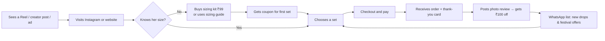
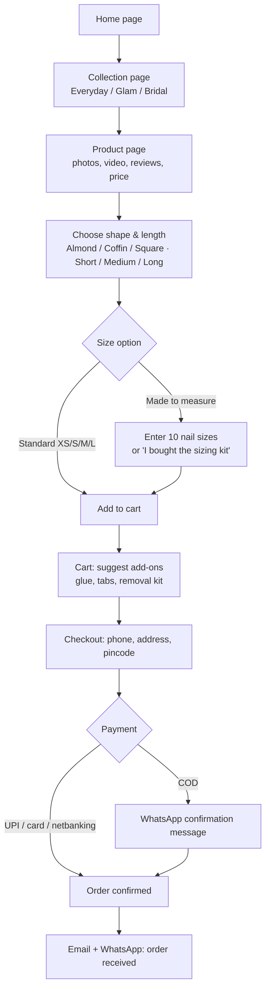
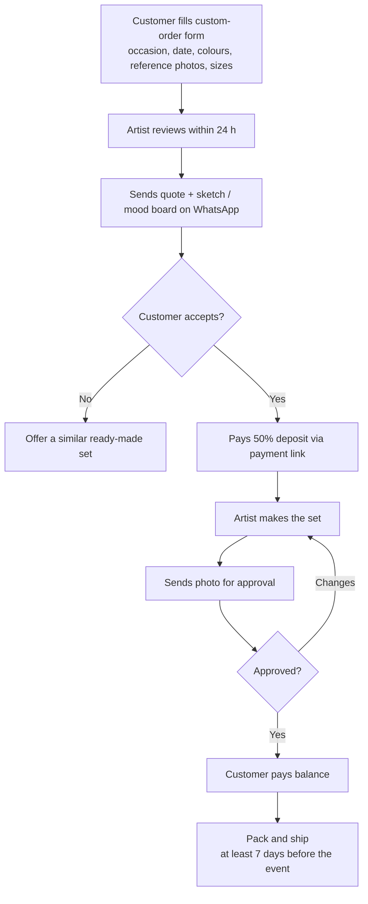
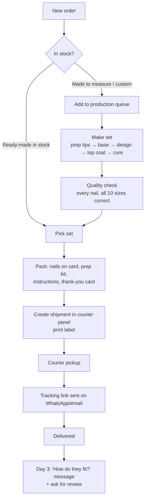
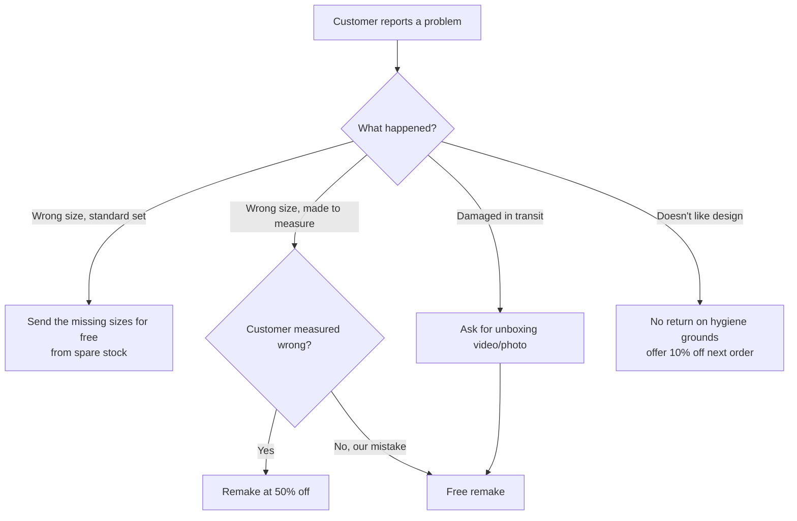

# 2. Customer and Order Flows

These diagrams render on GitHub. They show the journey for the customer and the work behind each order.

## 2.1 Big picture: from stranger to repeat customer

## 2.2 Buying a ready-made set on the website

## 2.3 Custom / bridal order

Custom work takes the artist's time, so take a deposit before starting.

## 2.4 Behind the scenes: from order to doorstep

**Target timings:**
- Ready-made: ship within 1–2 days
- Made-to-measure: ship within 3–5 days
- Custom / bridal: 7–14 days (state this clearly on the website)

## 2.5 Problem handling: wrong size, damage, returns

> Press-on nails are a personal hygiene product, so a "no returns once opened" policy is normal. Be generous on fit and damage — good reviews are worth more than one set.

## 2.6 Daily routine for running the shop

| Time | Task | Who |
|------|------|-----|
| Morning | Check new orders, confirm COD orders on WhatsApp, print labels | Husband / helper |
| Morning | Pack yesterday's finished sets, hand over to courier | Husband / helper |
| Day | Make sets from the production queue | Artist |
| Day | Film process clips while working (phone on a tripod) | Artist |
| Evening | Post 1 Reel, reply to DMs and comments | Either |
| Weekly | Look at the numbers (see business plan 1.7), plan next week's content, restock materials | Both |
| Monthly | Release a new design drop | Artist |

Splitting the work this way keeps the artist making and filming, and the other person handling orders, shipping, and customer messages.
