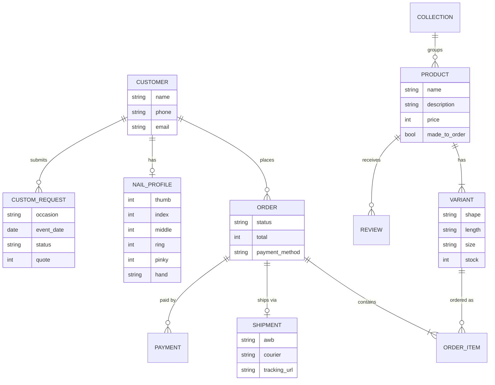
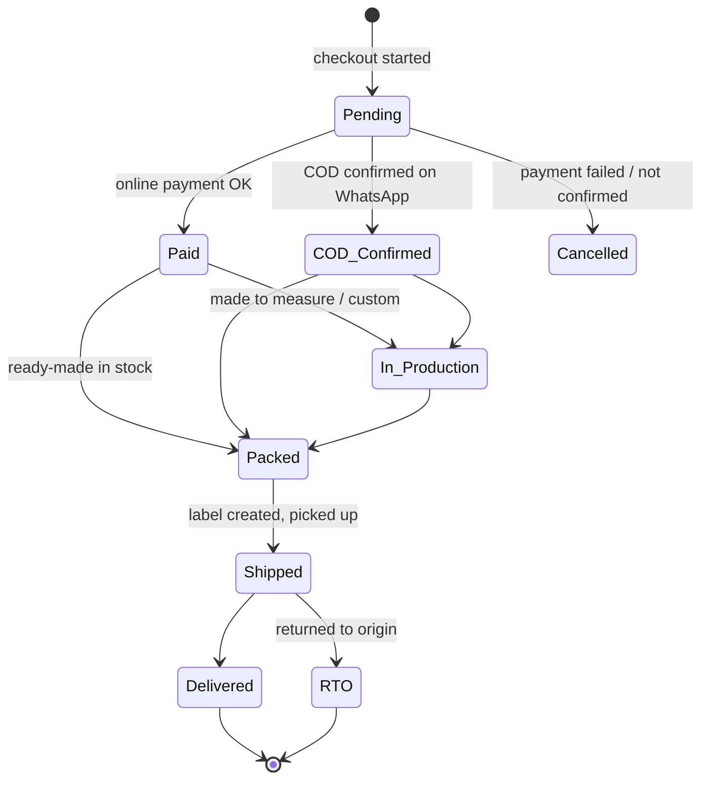

# 3. Website Build Plan

## 3.1 Two ways to build it

| | **Option A: Shopify (or Dukaan / WooCommerce)** | **Option B: Custom-built site (this repo)** |
|---|---|---|
| Time to launch | 1–2 weeks | 4–8 weeks |
| Monthly cost | ~₹2,000–3,000 + apps | ~₹0–1,000 hosting + domain |
| Coding needed | None | Yes |
| Flexibility | Good, limited by themes/apps | Full control (custom sizing tool, custom-order flow) |
| Maintenance | Done for you | We maintain it |

**Recommendation:** If no one in the family codes, launch on **Shopify** first; it already handles checkout, Razorpay, Shiprocket, and COD. Build the custom site in this repo only if you want full control or to save on monthly fees once orders are steady. The pages and features below apply to both options.

## 3.2 Pages

| Page | Must have |
|------|-----------|
| **Home** | Hero video of the nails, best sellers, "handmade by a nail artist" story, reviews, Instagram feed |
| **Collections** | Filter by collection, shape, length, price |
| **Product** | 5+ photos (on hand, close-up, box), short video, price, shape/length/size picker, add-ons, reviews, "what's in the box" |
| **Sizing guide** | Step-by-step photos and video, size chart, link to sizing kit |
| **Custom order** | Form: occasion, event date, colours, reference photo upload, sizes, budget |
| **How to apply / remove** | Video tutorials (also reduces support messages) |
| **About** | The artist's story and photos |
| **Cart & checkout** | Add-on suggestions, coupon box, pincode check, UPI/card/COD |
| **Order tracking** | Enter order number or phone → see status |
| **Account** | Past orders, saved nail sizes (so repeat orders are one click) |
| **Policies** | Shipping, Returns & Refunds, Privacy, Terms, Contact (needed for payment gateway approval) |

## 3.3 Features by phase

### Phase 1 — Launch (must have)
- Product catalogue with variants (shape, length, size)
- Cart, checkout, coupon codes
- Payments: Razorpay (UPI, cards, netbanking, wallets) + COD
- Shipping: Shiprocket integration (rates, labels, tracking)
- Order emails + WhatsApp notifications
- Sizing guide page + sizing kit product
- Admin: add products, see orders, update order status
- Mobile-first design (most customers will come from Instagram on a phone)
- Basic SEO: page titles, descriptions, image alt text, sitemap

### Phase 2 — Grow
- Customer accounts with **saved nail sizes**
- Photo reviews
- Custom-order form with photo upload and deposit payment
- Bundle offers ("any 3 for ₹1,999") and free-shipping threshold bar
- Abandoned-cart reminder on WhatsApp/email
- Meta Pixel + Google Analytics for ads

### Phase 3 — Extra
- Loyalty points / referral codes
- "Design drop" countdown pages and waitlist
- Virtual try-on (upload hand photo, preview design)
- Salon/home-service booking calendar
- Marketplace sync (Amazon/Meesho) and international shipping

## 3.4 Suggested tech stack for the custom build (Option B)

| Part | Choice | Why |
|------|--------|-----|
| Frontend + backend | **Next.js** (React, TypeScript) | One codebase, fast, good SEO |
| Styling | Tailwind CSS | Quick to build a clean, mobile-first design |
| Database + auth + file storage | **Supabase** (Postgres) | Free tier, login with phone OTP, image storage |
| Payments | **Razorpay** | UPI, cards, COD support, Indian KYC |
| Shipping | **Shiprocket API** | Rates, labels, tracking across many couriers |
| Images | Supabase Storage or Cloudinary | Resized, fast product images |
| Email | Resend / Brevo | Order emails |
| WhatsApp | WhatsApp Business API via Interakt / AiSensy / Gupshup | Order updates, COD confirmation |
| Hosting | Vercel | Free to start, easy deploys from GitHub |

### Main data model



### Order status flow



### Suggested folder layout

```
nails-ecom/
├── docs/                 # these plan documents
├── src/
│   ├── app/              # Next.js pages (home, collections, product, cart, checkout, account, admin)
│   ├── components/       # UI pieces (ProductCard, SizePicker, CartDrawer…)
│   ├── lib/              # razorpay.ts, shiprocket.ts, supabase.ts, whatsapp.ts
│   └── types/
├── supabase/migrations/  # database tables
└── public/               # logo, static images
```

## 3.5 Build order (custom site)

1. **Week 1** – Project setup, design system (colours, fonts), home and product pages with sample data
2. **Week 2** – Database, admin page to add products and photos, collections and filters
3. **Week 3** – Cart, checkout, Razorpay payments, COD, order emails
4. **Week 4** – Shiprocket integration, order tracking, policy pages, sizing guide
5. **Week 5** – Testing on phones, real product photos, SEO, go live
6. **After launch** – Phase 2 features, one at a time, based on what customers ask for

## 3.6 Launch checklist

- [ ] All products have photos, prices, and stock
- [ ] Test order with real payment (then refund it)
- [ ] Test COD order end to end
- [ ] Shipping label and pickup tested
- [ ] Policy pages live; payment gateway KYC approved
- [ ] Site checked on Android and iPhone
- [ ] Google Analytics + Meta Pixel installed
- [ ] Instagram bio link and WhatsApp catalogue point to the site
- [ ] Launch coupon ready for the first customers
